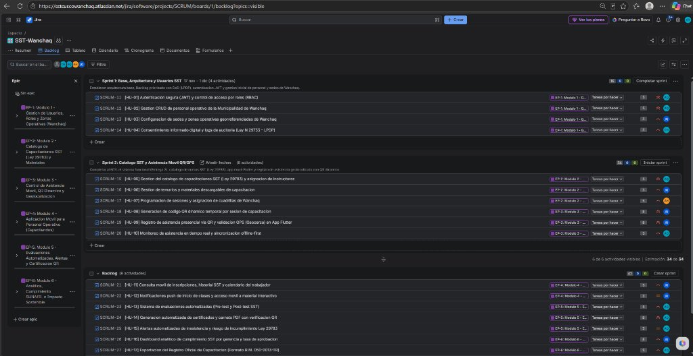
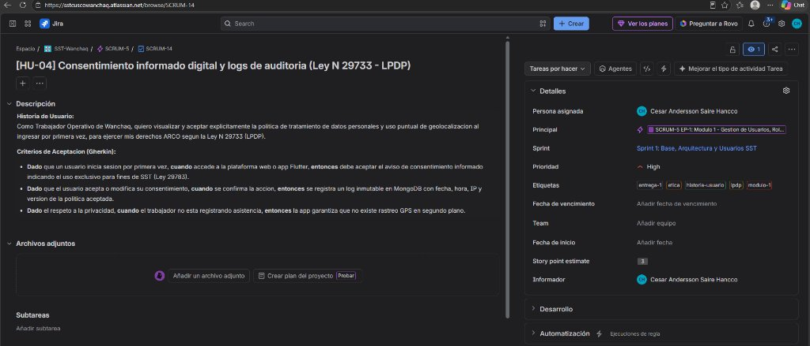
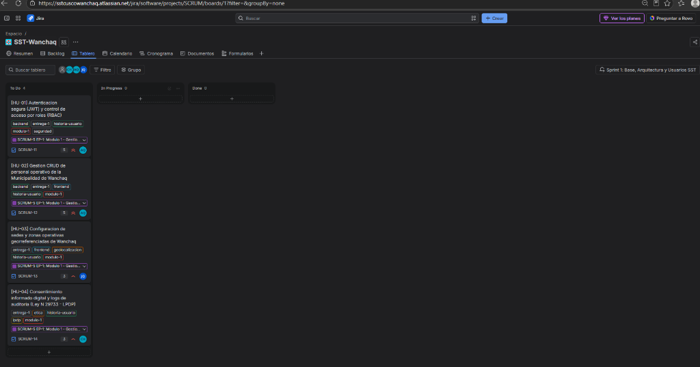
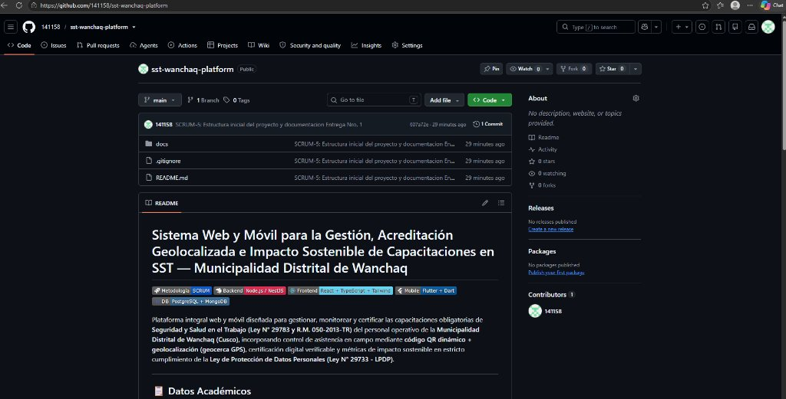
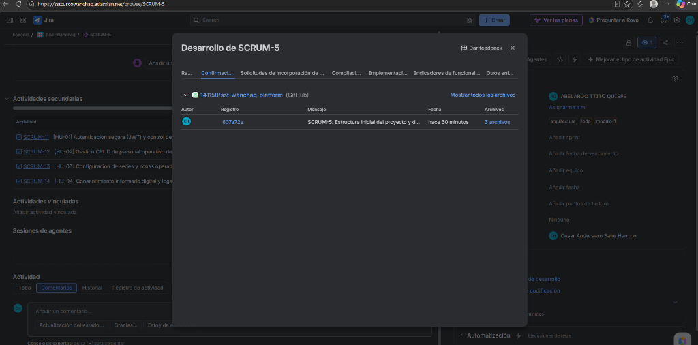

# PROYECTO DE INGENIERÍA DE SOFTWARE I — ENTREGA NRO. 1

**Universidad Nacional de San Antonio Abad del Cusco (UNSAAC)**  
**Escuela Profesional de Ingeniería Informática y de Sistemas**  
**Asignatura:** Ingeniería de Software I  

**Título del Proyecto:**  
*Diseño e Implementación de un Sistema Web y Móvil para la Gestión, Acreditación Geolocalizada e Impacto Sostenible de Capacitaciones en Seguridad y Salud en el Trabajo (Ley N° 29783) en el Personal Operativo de la Municipalidad Distrital de Wanchaq*

**Integrantes del Equipo Scrum:**
- **Cesar Andersson Saire Hancco** — Código: `141158` *(Scrum Master)*
- **Andy Yoseph Quispe Huanca** — Código: `221949` *(Product Owner)*
- **Abelardo Ttito Quispe** — Código: `192430` *(Developer 1 — Fullstack / Lead Backend)*
- **Jean Marco Pacha Quispe** — Código: `164246` *(Developer 2 — Mobile / Frontend Developer)*

**Repositorio GitHub:** [https://github.com/141158/sst-wanchaq-platform](https://github.com/141158/sst-wanchaq-platform)  
**Tablero Scrum (Jira):** [https://sstcuscowanchaq.atlassian.net](https://sstcuscowanchaq.atlassian.net)

---

# CAPÍTULO I: DATOS GENERALES DEL PROYECTO

## 1.1. Título del Proyecto
**Diseño e Implementación de un Sistema Web y Móvil para la Gestión, Acreditación Geolocalizada e Impacto Sostenible de Capacitaciones en Seguridad y Salud en el Trabajo (Ley N° 29783) en el Personal Operativo de la Municipalidad Distrital de Wanchaq.**

---

## 1.2. Objetivos del Proyecto

### Objetivo General
Diseñar e implementar una plataforma web y móvil integral para la gestión, seguimiento en campo, certificación digital y evaluación del impacto sostenible de los programas obligatorios de capacitación en Seguridad y Salud en el Trabajo (SST) dirigidos al personal operativo de la Municipalidad Distrital de Wanchaq (Cusco), optimizando la asignación de instructores, el control de asistencia geolocalizada, la emisión automatizada de certificados verificables con código QR y el cumplimiento normativo mediante la metodología ágil SCRUM.

### Objetivos Específicos
1. **Gestionar eficientemente el padrón de capacitandos, instructores, cursos SST y sedes operativas** del distrito de Wanchaq (Palacio Municipal, Planta de Maestranza, Vivero Municipal y frentes de obra pública), categorizando al personal por área operativa y garantizando el cumplimiento de la Ley de Protección de Datos Personales (Ley N° 29733).
2. **Implementar un módulo móvil en Flutter para el control de asistencia en campo y seguimiento en tiempo real**, integrando códigos QR dinámicos temporales y validación de geolocalización por geocerca GPS con soporte *offline-first* para cuadrillas con conectividad intermitente.
3. **Automatizar la evaluación de aprendizaje y la generación de certificados y carnets digitales verificables** en formato PDF con código QR único, asegurando la autenticidad ante inspecciones internas o auditorías externas sin riesgo de falsificación.
4. **Proveer un dashboard analítico de cumplimiento normativo e impacto sostenible**, permitiendo monitorear la meta legal de cuatro (4) capacitaciones anuales por trabajador (Ley N° 29783), exportar el registro oficial en formato R.M. 050-2013-TR (auditable ante SUNAFIL/SERVIR) y cuantificar el impacto social, económico y ambiental (reducción de uso de papel y trazabilidad preventiva).

---

## 1.3. Alcance del Sistema

El sistema abarca la gestión del ciclo de vida completo de las capacitaciones de Seguridad y Salud en el Trabajo (SST) dentro del caso de estudio de la **Municipalidad Distrital de Wanchaq**, desde la planificación del Plan Anual de SST hasta la emisión de certificados verificables y la generación de reportes gerenciales e indicadores de sostenibilidad.

Aunque el caso de estudio y validación corresponde a la Municipalidad Distrital de Wanchaq, la arquitectura del software se diseña de manera modular y parametrizable (entidades de Sedes, Áreas Operativas y Cuadrillas), permitiendo su escalabilidad hacia cualquier gobierno local o entidad pública de la región Cusco.

### Módulos Incluidos en el Alcance
- **Módulo 1 — Gestión de Usuarios, Roles y Zonas/Sedes Operativas:** Autenticación JWT, control de acceso basado en roles (Administrador SST, Instructor/Capataz, Personal Operativo), padrón de trabajadores por gerencia/área (Limpieza Pública, Parques y Jardines, Obras Públicas, Serenazgo), georreferenciación de sedes con geocercas GPS y gestión del consentimiento informado LPDP.
- **Módulo 2 — Gestión del Catálogo de Capacitaciones SST y Materiales:** Administración de cursos obligatorios (IPERC, Uso de EPPs, Primeros Auxilios, Ergonomía, Manejo Defensivo, Simulacros), carga de temarios y guías descargables en PDF, asignación de instructores y programación de sesiones por cuadrillas sin cruce de horarios.
- **Módulo 3 — Monitoreo, Control de Asistencia y Geolocalización Móvil:** Generación de códigos QR dinámicos con expiración corta por sesión, marcado de asistencia desde la aplicación móvil Flutter validando la ubicación GPS puntual dentro de la geocerca autorizada, monitoreo en tiempo real y sincronización *offline-first*.
- **Módulo 4 — Aplicación Móvil para Capacitandos (Personal Operativo):** Consulta de sesiones programadas, barra de progreso respecto a la cuota legal anual (4 capacitaciones/año), notificaciones push de recordatorio, acceso a material de estudio y descarga de carnets/certificados digitales.
- **Módulo 5 — Sistema de Evaluaciones, Certificación Digital y Alertas:** Cuestionarios automatizados (pre-test y post-test) con calificación inmediata, alertas de inasistencia o incumplimiento próximo de la cuota anual, y generación automatizada de certificados/carnets PDF firmados institucionalmente con código QR de verificación pública.
- **Módulo 6 — Analítica, Cumplimiento Normativo e Impacto Sostenible (Dashboard):** Panel interactivo de cobertura SST por área municipal, tasa de aprobación, exportación del Registro Oficial de Inducción, Capacitación, Entrenamiento y Simulacros de Emergencia en formato **R.M. 050-2013-TR**, y cálculo de métricas sostenibles (ahorro de papel, huella de carbono evitada, horas-hombre capacitadas e inclusión laboral).

### Exclusiones / Limitaciones del Alcance
- No incluye la integración directa con sistemas legados internos de planillas (SIAF/SIGA) de la municipalidad; la carga de personal se gestiona mediante formularios del sistema o importación controlada.
- No contempla rastreo GPS continuo en segundo plano de los trabajadores; la geolocalización se captura exclusivamente en el instante puntual de validación de asistencia, en estricto respeto de la privacidad y la Ley N° 29733.

---

## 1.4. Justificación del Proyecto

### Problemática Local (Municipalidad Distrital de Wanchaq — Cusco)
El distrito de Wanchaq constituye uno de los polos urbanos más dinámicos y densos de la provincia del Cusco, demandando la operación continua de cuadrillas municipales de Limpieza Pública, Mantenimiento de Parques y Jardines, Serenazgo e Infraestructura/Obras Públicas en distintos frentes de trabajo (Av. de la Cultura, Marcavalle, Magisterio, Progreso, Planta de Maestranza, Vivero Municipal, entre otros).

Actualmente, en el entorno municipal y de obras públicas de la región Cusco, el registro de capacitaciones y charlas de seguridad suele ejecutarse mediante **planillas físicas en papel y hojas de cálculo aisladas**. Esta gestión manual genera problemáticas críticas:
1. **Riesgo de sanciones legales:** La **Ley N° 29783 (Ley de Seguridad y Salud en el Trabajo)** y su Reglamento (**D.S. N° 005-2012-TR**) obligan al empleador a impartir al menos **cuatro (4) capacitaciones anuales** por trabajador y conservar registros auditables durante 5 años según los formatos referenciales de la **R.M. N° 050-2013-TR**. El extravío de hojas de asistencia o firmas incompletas expone a la entidad a observaciones de **SERVIR** y multas de **SUNAFIL**.
2. **Falta de trazabilidad y suplantación en campo:** Al ejecutarse charlas de inducción y seguridad en zonas abiertas y obras dispersas, resulta difícil verificar que el trabajador estuvo físicamente presente en el horario y lugar programado.
3. **Retraso y vulnerabilidad en certificados:** La emisión manual de constancias demora semanas y carece de mecanismos de verificación instantánea ante supervisores de obra, facilitando la adulteración documental.
4. **Invisibilidad del impacto y alto consumo de papel:** No se dispone de indicadores consolidados en tiempo real sobre tasas de aprendizaje, brechas por gerencia ni del impacto ambiental asociado al uso intensivo de papelería.

### Justificación Tecnológica, Social y Sostenible
La implementación de una plataforma web y móvil resuelve integralmente estas deficiencias:
- **Justificación Legal y Operativa:** Digitaliza fielmente el formato R.M. 050-2013-TR y asegura evidencia fehaciente mediante QR dinámico + geocerca GPS.
- **Justificación Social:** Promueve la equidad en el acceso a la formación preventiva del personal operativo de campo, reduciendo la exposición a accidentes laborales y enfermedades ocupacionales.
- **Justificación Ambiental y Económica:** Elimina el uso masivo de planillas impresas y certificados físicos, reduciendo costos administrativos y generando un indicador medible de sostenibilidad institucional en Wanchaq.

---

## 1.5. Tecnologías Utilizadas

De acuerdo con los lineamientos del curso y la arquitectura cliente-servidor multiplataforma requerida, el equipo seleccionó el siguiente stack tecnológico:

| Categoría | Tecnología Seleccionada | Justificación Técnica |
| :--- | :--- | :--- |
| **Backend (API REST)** | **Node.js + NestJS (TypeScript)** | Framework modular y escalable basado en arquitectura por capas e inyección de dependencias; permite tipado estricto compartido con el frontend y manejo ágil de JWT, PDF y QR. |
| **Frontend Web** | **React + TypeScript + Tailwind CSS** | Librería moderna basada en componentes reutilizables ideal para dashboards analíticos interactivos, combinada con Tailwind CSS para un diseño responsivo rápido y consistente. |
| **Aplicación Móvil** | **Dart + Flutter** | Framework multiplataforma (Android/iOS) con alto rendimiento nativo para el acceso a la cámara (escáner QR), sensor GPS (geocercas) y almacenamiento local *offline-first*. |
| **Base de Datos Relacional** | **PostgreSQL** | Motor robusto compatible con ACID, ideal para modelar usuarios, roles, sedes, catálogo SST, sesiones, asistencias y certificados garantizando integridad referencial. |
| **Base de Datos NoSQL** | **MongoDB** | Base de datos orientada a documentos utilizada para logs inmutables de auditoría (consentimiento LPDP, intentos GPS) y analítica flexible de resultados de evaluaciones. |
| **Gestión Ágil (Scrum)** | **Jira Software Cloud** | Gestión profesional del Product Backlog, Épicas, Historias de Usuario, Story Points, Sprints y trazabilidad directa con ramas y commits de GitHub. |
| **Control de Versiones** | **Git + GitHub** | Repositorio centralizado ([141158/sst-wanchaq-platform](https://github.com/141158/sst-wanchaq-platform)) integrado nativamente con Jira mediante *GitHub for Jira*. |
| **Diseño UI/UX** | **Figma** | Prototipado colaborativo de wireframes y pantallas web y móviles previo al desarrollo. |
| **Comunicación** | **Discord / WhatsApp** | Coordinación de Daily Scrums, revisiones rápidas y comunicación continua del equipo. |
| **Despliegue Cloud (Final)** | **Vercel / Render / Railway** | Infraestructura moderna en la nube para el despliegue continuo de frontend, API y bases de datos en la Entrega Final. |

---

## 1.6. Roles del Equipo Scrum

El equipo está conformado por cuatro (4) integrantes, asignando roles alineados al marco de trabajo Scrum:

| Integrante | Código | Rol Scrum | Funciones en el Proyecto |
| :--- | :---: | :--- | :--- |
| **Cesar Andersson Saire Hancco** | `141158` | **Scrum Master** | Facilita las ceremonias Scrum (Sprint Planning, Daily Scrums, Sprint Review y Retrospective), elimina bloqueos técnicos u organizativos, administra el flujo en Jira y verifica el cumplimiento estricto de la *Definition of Done* (incluyendo los lineamientos éticos y legales de la LPDP). |
| **Andy Yoseph Quispe Huanca** | `221949` | **Product Owner** | Representa las necesidades del caso de estudio (Comité de SST de Wanchaq), define y prioriza el Product Backlog maximizando el valor normativo y social, redacta y valida los criterios de aceptación de cada Historia de Usuario y aprueba los incrementos en cada Sprint Review. |
| **Abelardo Ttito Quispe** | `192430` | **Developer 1 (Fullstack / Lead Backend)** | Diseña e implementa la arquitectura REST API en Node.js (NestJS), el modelo relacional en PostgreSQL, los esquemas de auditoría en MongoDB, la autenticación JWT/RBAC, la generación de certificados PDF/QR y la exportación oficial R.M. 050-2013-TR. |
| **Jean Marco Pacha Quispe** | `164246` | **Developer 2 (Mobile / Frontend Developer)** | Desarrolla la aplicación móvil multiplataforma en Flutter (escaneo de QR dinámico, validación GPS por geocerca, portal del capacitando y sincronización offline) así como la interfaz administrativa y el dashboard analítico web en React + TypeScript + Tailwind CSS. |

---

## 1.7. Público Objetivo del Sistema

1. **Administradores / Coordinadores de SST (Oficina de RRHH y Comité de SST de Wanchaq):** Encargados de planificar el calendario anual de capacitaciones, gestionar el padrón de personal operativo, configurar sedes georreferenciadas, monitorear el cumplimiento legal y exportar reportes para auditorías.
2. **Instructores / Ponentes / Capataces de SST:** Encargados de impartir las capacitaciones presenciales y charlas de seguridad en campo, publicar materiales de apoyo, generar los códigos QR dinámicos de asistencia y gestionar las evaluaciones de conocimiento.
3. **Personal Operativo / Capacitandos (Limpieza Pública, Parques y Jardines, Obras Públicas y Serenazgo):** Trabajadores municipales que asisten a las capacitaciones, registran su asistencia desde su dispositivo móvil, rinden evaluaciones y descargan sus certificados/carnets digitales verificables.
4. **Actores Externos de Verificación (Supervisores de Obra, SUNAFIL y SERVIR):** Entidades o inspectores que pueden validar de manera pública e instantánea la autenticidad de un certificado SST mediante el escaneo de su código QR.

---

# CAPÍTULO II: MÉTODO SCRUM APLICADO (BOSQUEJO — ENTREGA NRO. 1)

## 2.1. Product Backlog Inicial Priorizado

El Product Backlog inicial fue estructurado y priorizado directamente en **Jira Software** (Proyecto `SST-Wanchaq`, clave `SCRUM`), organizando los **Requisitos Funcionales (RF)** en **6 Épicas** correspondientes a los módulos del sistema y **18 Historias de Usuario (HU)** estimadas mediante la escala de Fibonacci (*Story Points*, totalizando **92 Story Points**).

### A. Resumen de Épicas (Módulos en Jira)

| Clave Jira | Código | Épica / Módulo Funcional | Prioridad | Responsable |
| :---: | :---: | :--- | :---: | :--- |
| `SCRUM-5` | EP-1 | Módulo 1 — Gestión de Usuarios, Roles y Zonas Operativas (Wanchaq) | Highest | Abelardo Ttito |
| `SCRUM-6` | EP-2 | Módulo 2 — Catálogo de Capacitaciones SST (Ley 29783) y Materiales | Highest | Andy Quispe |
| `SCRUM-7` | EP-3 | Módulo 3 — Control de Asistencia Móvil, QR Dinámico y Geolocalización | Highest | Jean Marco Pacha |
| `SCRUM-8` | EP-4 | Módulo 4 — Aplicación Móvil para Personal Operativo (Capacitandos) | High | Jean Marco Pacha |
| `SCRUM-9` | EP-5 | Módulo 5 — Evaluaciones Automatizadas, Alertas y Certificación QR | High | Abelardo Ttito |
| `SCRUM-10` | EP-6 | Módulo 6 — Analítica, Cumplimiento SUNAFIL e Impacto Sostenible | Medium | Cesar Saire |

### B. Listado Priorizado de Historias de Usuario (Requisitos Funcionales)

| Clave Jira | ID | Épica | Historia de Usuario (Resumen) | Prioridad | Story Points | Sprint Planificado | Responsable |
| :---: | :---: | :---: | :--- | :---: | :---: | :---: | :--- |
| `SCRUM-11` | HU-01 | EP-1 | Autenticación segura (JWT) y control de acceso por roles (RBAC) | Highest | 5 | Sprint 1 | Abelardo Ttito |
| `SCRUM-12` | HU-02 | EP-1 | Gestión CRUD de personal operativo de la Municipalidad de Wanchaq | Highest | 5 | Sprint 1 | Abelardo Ttito |
| `SCRUM-13` | HU-03 | EP-1 | Configuración de sedes y zonas operativas georreferenciadas de Wanchaq | High | 3 | Sprint 1 | Jean Marco Pacha |
| `SCRUM-14` | HU-04 | EP-1 | Consentimiento informado digital y logs de auditoría (Ley N° 29733 - LPDP) | High | 3 | Sprint 1 | Cesar Saire |
| `SCRUM-15` | HU-05 | EP-2 | Gestión del catálogo de capacitaciones SST (Ley 29783) y asignación de instructores | Highest | 5 | Sprint 2 | Abelardo Ttito |
| `SCRUM-16` | HU-06 | EP-2 | Gestión de temarios y materiales descargables de capacitación | High | 3 | Sprint 2 | Jean Marco Pacha |
| `SCRUM-17` | HU-07 | EP-2 | Programación de sesiones y asignación de cuadrillas de Wanchaq | High | 5 | Sprint 2 | Andy Quispe |
| `SCRUM-18` | HU-08 | EP-3 | Generación de código QR dinámico temporal por sesión de capacitación | Highest | 8 | Sprint 2 | Jean Marco Pacha |
| `SCRUM-19` | HU-09 | EP-3 | Registro de asistencia presencial vía QR y validación GPS (Geocerca) en App Flutter | Highest | 8 | Sprint 2 | Jean Marco Pacha |
| `SCRUM-20` | HU-10 | EP-3 | Monitoreo de asistencia en tiempo real y sincronización *offline-first* | High | 5 | Sprint 2 | Abelardo Ttito |
| `SCRUM-21` | HU-11 | EP-4 | Consulta móvil de inscripciones, historial SST y calendario del trabajador | High | 5 | Sprint 3 *(Backlog)* | Jean Marco Pacha |
| `SCRUM-22` | HU-12 | EP-4 | Notificaciones push de inicio de clases y acceso móvil a material interactivo | Medium | 3 | Sprint 3 *(Backlog)* | Jean Marco Pacha |
| `SCRUM-23` | HU-13 | EP-5 | Sistema de evaluaciones automatizadas (Pre-test y Post-test SST) | High | 5 | Sprint 3 *(Backlog)* | Abelardo Ttito |
| `SCRUM-24` | HU-14 | EP-5 | Generación automatizada de certificados y carnets PDF con verificación QR | Highest | 8 | Sprint 3 *(Backlog)* | Abelardo Ttito |
| `SCRUM-25` | HU-15 | EP-5 | Alertas automatizadas de inasistencia y riesgo de incumplimiento Ley 29783 | Medium | 3 | Sprint 4 *(Backlog)* | Abelardo Ttito |
| `SCRUM-26` | HU-16 | EP-6 | Dashboard analítico de cumplimiento SST por gerencia y tasa de aprobación | High | 8 | Sprint 4 *(Backlog)* | Jean Marco Pacha |
| `SCRUM-27` | HU-17 | EP-6 | Exportación del Registro Oficial de Capacitación (Formato R.M. 050-2013-TR) | High | 5 | Sprint 4 *(Backlog)* | Abelardo Ttito |
| `SCRUM-28` | HU-18 | EP-6 | Panel de métricas de impacto sostenible (Ambiental, Social y Económico) | Medium | 5 | Sprint 4 *(Backlog)* | Cesar Saire |

*Figura 1. Product Backlog inicial priorizado en Jira Software (`sstcuscowanchaq.atlassian.net`), mostrando el panel de 6 Épicas, Sprint 1 (16 SP), Sprint 2 (34 SP) y Backlog priorizado (42 SP) con responsables asignados.*

*Figura 2. Detalle de la Historia de Usuario `SCRUM-14` (`[HU-04] Consentimiento informado digital y logs de auditoría - Ley N° 29733 LPDP`), evidenciando formato Como/Quiero/Para, criterios de aceptación Gherkin, Story Points y vinculación a la Épica `SCRUM-5`.*

### C. Requisitos No Funcionales (RNF)

| Código | Categoría | Descripción del Requisito No Funcional |
| :---: | :--- | :--- |
| **RNF-01** | Seguridad y Cifrado | Toda comunicación cliente-servidor deberá realizarse bajo HTTPS/TLS. Las contraseñas se cifrarán con `bcrypt`/`argon2` y las sesiones emplearán JWT con expiración controlada. |
| **RNF-02** | Privacidad y LPDP | El sistema cumplirá la **Ley N° 29733 (LPDP)** recabando consentimiento expreso, garantizando derechos ARCO, aplicando minimización de datos y prohibiendo el rastreo GPS continuo en segundo plano. |
| **RNF-03** | Rendimiento | El tiempo de respuesta de los endpoints REST críticos (validación de QR y registro de asistencia) no deberá exceder los 2 segundos bajo carga concurrente de una cuadrilla (50 usuarios simultáneos). |
| **RNF-04** | Disponibilidad / Offline | La app móvil Flutter deberá tolerar cortes temporales de internet en zonas de obra, encolando registros cifrados localmente para su sincronización automática al restablecer señal. |
| **RNF-05** | Usabilidad | La interfaz móvil presentará controles de alto contraste, tipografía legible y flujos de máximo 3 toques para facilitar su uso por personal operativo de campo con variada alfabetización digital. |
| **RNF-06** | Integridad Legal | Los registros de asistencia y certificados emitidos contarán con sello temporal (*timestamp*), código hash verificable y borrado lógico para asegurar conservación auditable mínima de 5 años (D.S. 005-2012-TR). |

### D. Definition of Done (DoD) con Aspectos Éticos y Legales (LPDP)

Una Historia de Usuario o tarea en Jira solo podrá transicionar al estado **"Listo / Done"** cuando cumpla simultáneamente con los siguientes criterios verificados por el Scrum Master y el Product Owner:

1. **Criterios Técnicos y de Código:**
   - Código fuente implementado siguiendo los estándares de TypeScript (NestJS/React) y Dart (Flutter) sin errores de compilación ni advertencias críticas de linter.
   - Commits debidamente enlazados a la clave de Jira correspondiente (ej. `SCRUM-11: Implementar guard JWT`) y Pull Request revisado y aprobado por al menos un compañero en GitHub.
   - Pruebas unitarias y funcionales básicas ejecutadas exitosamente validando todos los Criterios de Aceptación (Gherkin).
2. **Criterios Éticos y Legales (Cumplimiento LPDP — Ley N° 29733):**
   - **Principio de Consentimiento y Finalidad:** Ningún formulario recopila datos personales innecesarios; los datos del trabajador (DNI, nombre, área) se usan exclusivamente para acreditación de SST bajo consentimiento informado registrado.
   - **Privacidad de Geolocalización:** Se verifica explícitamente en pruebas móviles que el permiso GPS se invoca únicamente durante la acción puntual de marcado de asistencia y se libera de inmediato (cero vigilancia encubierta).
   - **Seguridad y Confidencialidad:** No existen credenciales, claves API ni datos personales reales expuestos en el repositorio público de GitHub (uso estricto de `.env` y datos sintéticos/anonimizados para pruebas).
   - **Equidad e Inclusión:** La interfaz no discrimina por nivel técnico ni tipo de dispositivo Android de gama baja/media.
3. **Criterios de Gestión y Documentación:**
   - Documentación técnica o diagramas UML impactados se encuentran actualizados.
   - Historia validada y aceptada por el Product Owner en Jira con evidencia adjunta.

---

## 2.2. Planificación de Sprints

El desarrollo completo del sistema se planifica en **4 Sprints** alineados a los tres hitos de evaluación del curso (Semanas 2, 6 y 16):

- **Número total de Sprints:** 4 Sprints
- **Duración:** Sprints de 2 a 4 semanas según hitos académicos del semestre (16 semanas totales).

| Sprint | Periodo Académico | Objetivo del Sprint | Historias Incluidas | Story Points | Entregable Asociado |
| :--- | :---: | :--- | :---: | :---: | :--- |
| **Sprint 1** *(Activo)* | Semanas 1 – 2 | Planificación Scrum, arquitectura base, repositorios, DoD (LPDP), autenticación JWT y gestión inicial de personal y sedes de Wanchaq. | `HU-01`, `HU-02`, `HU-03`, `HU-04` | **16 SP** | **Entrega Nro. 1 (Sem. 2):** Cap. I y Bosquejo Cap. II + Backlog en Jira + Base del proyecto. |
| **Sprint 2** *(Planificado)* | Semanas 3 – 6 | Desarrollo del núcleo funcional web y app móvil: catálogo SST (Ley 29783), programación de sesiones y control de asistencia en campo con QR dinámico y geocerca GPS. | `HU-05`, `HU-06`, `HU-07`, `HU-08`, `HU-09`, `HU-10` | **34 SP** | **Entrega Nro. 2 (Sem. 6):** Cap. I, II mejorado, Bosquejo III + **Sistema funcional al 50%**. |
| **Sprint 3** *(Backlog)* | Semanas 7 – 11 | Implementación del portal móvil del trabajador, notificaciones push, evaluaciones automatizadas y emisión de certificados/carnets PDF verificables con QR. | `HU-11`, `HU-12`, `HU-13`, `HU-14` | **21 SP** | Incremento funcional (80%): App Capacitando + Evaluaciones + Certificados QR. |
| **Sprint 4** *(Backlog)* | Semanas 12 – 16 | Dashboard gerencial de cumplimiento SST, alertas Ley 29783, exportación R.M. 050-2013-TR, métricas de impacto sostenible, pruebas finales y despliegue en Cloud. | `HU-15`, `HU-16`, `HU-17`, `HU-18` | **21 SP** | **Entrega Nro. 3 (Sem. 16):** Informe Final (Cap. I–VII), GitHub completo y **Sistema 100% en Cloud**. |

*Figura 3. Tablero activo del Sprint 1 ("Base, Arquitectura y Usuarios SST") en Jira Software, mostrando las columnas de flujo Scrum y las cuatro historias iniciales (`SCRUM-11` a `SCRUM-14`) asignadas al equipo.*

---

## 2.3. Herramientas de Colaboración Utilizadas

Para garantizar la trazabilidad, transparencia y comunicación ágil del equipo de 4 integrantes se emplean las siguientes herramientas integradas:

1. **Jira Software Cloud ([sstcuscowanchaq.atlassian.net](https://sstcuscowanchaq.atlassian.net)):** Gestión centralizada del Product Backlog, Épicas, Historias de Usuario, asignación de tareas, estimación en Story Points y seguimiento de Sprints.
2. **GitHub ([github.com/141158/sst-wanchaq-platform](https://github.com/141158/sst-wanchaq-platform)):** Control de versiones distribuido con flujo de ramas por funcionalidad (`feature/SCRUM-XX-descripcion`) y revisión mediante Pull Requests.
3. **Integración Jira + GitHub (*GitHub for Jira*):** Vinculación bidireccional que permite rastrear commits, ramas y Pull Requests directamente dentro de cada tarjeta de Historia de Usuario en Jira.
4. **Figma:** Diseño colaborativo de prototipos de baja y alta fidelidad (interfaces Web administrativas y vistas de la App Móvil Flutter).
5. **Discord / WhatsApp:** Canal de comunicación diaria para la coordinación de *Daily Scrums* (15 minutos), resolución rápida de impedimentos y coordinación de *Sprint Reviews*.

*Figura 4. Repositorio oficial en GitHub (`141158/sst-wanchaq-platform`), evidenciando la estructura inicial (`docs/`, `.gitignore`, `README.md`) y el primer commit trazado a Jira (`SCRUM-5`).*

*Figura 5. Panel "Desarrollo de SCRUM-5" en Jira Software mostrando la vinculación automática del commit `607a72e` desde el repositorio GitHub `141158/sst-wanchaq-platform`.*
